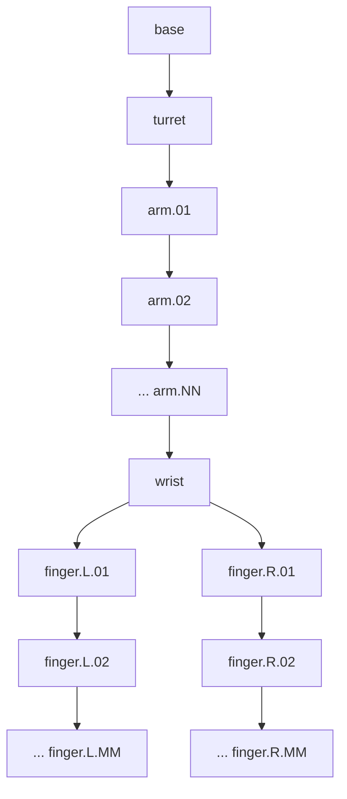
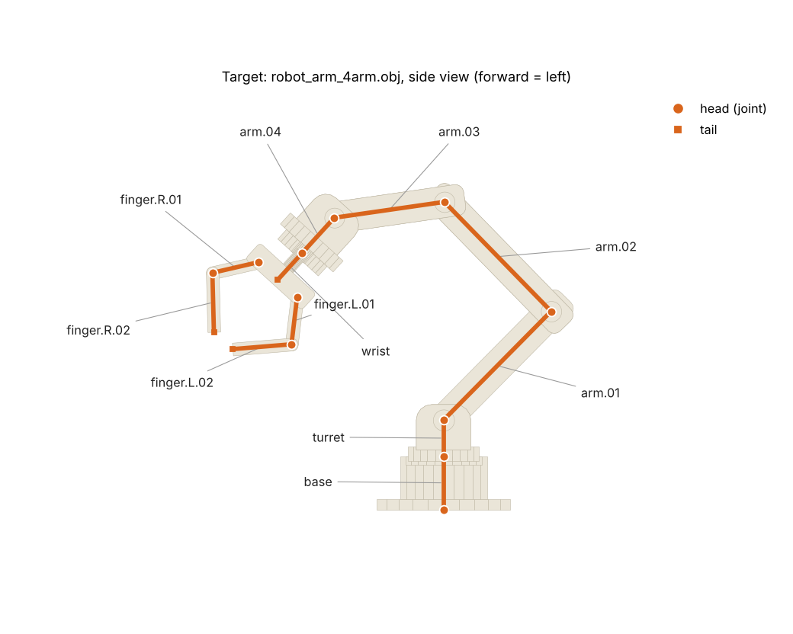

# DT475_Bones
HW03 - Creating Bones for Robot Arm

DT475 Animation and Modeling · Tested with **Blender 5.2**

# Worksheet: Bone Placement & Hierarchy for a Robot Arm

## Goal

You will write a Blender Python script that builds the skeleton of a robot arm: one bone per moving part, each bone placed on its joints and parented to the bone before it. Your script must not depend on a particular robot. It has to work for any number of arm segments, any segment length and angle, any number of finger segments, and for a model that has been moved or scaled in the scene.

The assignment covers bone **placement** (head and tail) and **hierarchy** (parent and child). Once your bones exist, the provided code binds each mesh rigidly to a single bone (no weight painting), so you can pose the robot in the 3D viewport and see whether the skeleton is right.

You hand in your finished script. It must run without errors on every test model you receive.

## Files and how to run

| File | What it is |
| --- | --- |
| [`bone_rig/bone_rig_template.py`](bone_rig/bone_rig_template.py) | The script you complete. Five functions are marked TODO; everything else is provided, including loading the model and binding the meshes to the bones. |
| [`bone_rig/OBJ/robot_arm_4arm.obj`](bone_rig/OBJ/robot_arm_4arm.obj) | Test model: 4 arm segments, 2 finger segments per finger. |
| [`bone_rig/OBJ/robot_arm_3arm.obj`](bone_rig/OBJ/robot_arm_3arm.obj) | Test model: 3 arm segments, 2 finger segments. |
| [`bone_rig/OBJ/robot_arm_2arm_3fingers.obj`](bone_rig/OBJ/robot_arm_2arm_3fingers.obj) | Test model: 2 arm segments, 3 finger segments, different lengths and angles. |
| [`bone_rig/robot_arms.blend`](bone_rig/robot_arms.blend) | The same three test robots, ready in Blender: one collection per robot (`robot_4arm`, `robot_3arm`, `robot_2arm_3fingers`). Object names look like `robot_4arm:arm.01`; the part name is the text after the colon. |
| [`bone_rig/create_robot_arm_named.py`](bone_rig/create_robot_arm_named.py) | Optional: builds a robot with any parameters, so you can make your own test models (see the challenge). |
| [`bone_rig/target_skeleton.png`](bone_rig/target_skeleton.png) | What a correct rig looks like (see Test your rig). |

**To run:** open `bone_rig/bone_rig_template.py` in Blender's Scripting workspace (Text > Open), choose how the robot is loaded with the setting `MODEL_SOURCE` at the top, and press **Run Script** (Alt+P).

- `MODEL_SOURCE = "COLLECTION"` (the default): open `bone_rig/robot_arms.blend`, click the name of one robot's collection in the Outliner (for example `robot_4arm`), and run. The robot is already in the scene, so nothing is imported, and the armature is created in the same collection.
- `MODEL_SOURCE = "OBJ"`: set `OBJ_PATH` to the full path of an OBJ file from `bone_rig/OBJ/` (keep the letter `r` before the quotes). The script clears the scene, imports the file into a new collection and rigs it.

Either way the script builds your armature, binds each mesh to its bone and prints the bones to the System Console (Window > Toggle System Console). Run it as often as you like: it removes the rig of the previous run first. Then test the result in the 3D viewport, as described under Test your rig.

The top of the template holds numbered footnotes, [1] to [11], that explain the Blender Python (bpy) functions and data you need. Comments in the code point to them, for example `# [5]`. Read them before you start. Also read `bind_meshes_rigidly`: its comments explain, step by step, how a mesh is bound to a bone.

From a terminal, with `MODEL_SOURCE = "OBJ"`, you can also run `blender -b -P bone_rig_template.py`.

## Background: head, tail and parent

A bone is a line segment with two ends: a **head** and a **tail**. When you pose a bone it rotates about its **head**, so the head must sit exactly on the joint where the part pivots.

A bone's **parent** is the bone it is attached to. Rotate a parent and every child, grandchild and so on moves with it. That is how turning the shoulder carries the whole arm and hand along.

Two placement rules give a clean skeleton:

- The **head** of a bone is the joint where it pivots on its parent.
- The **tail** of a bone is where its children begin. If it has several children, use the average of their heads. If it has none (a fingertip), use the far end of the part.

A bone is **connected** when its head is snapped onto its parent's tail (`use_connect`). That is natural in a chain. It is not possible at a fork: the wrist has two fingers, but a tail is a single point.

**Why the hinge axis matters.** Every hinge of this robot turns about the world X axis, and all joints lie in one plane. With bone roll left at 0, the local X axis of every bone is then the hinge axis. Rotating a bone about its local X axis bends the joint like the real hinge, and a positive angle swings the arm **forward** (toward the gripper side, the -Y direction).

## The robot: part names

The OBJ file holds one mesh object per part, named so that the name tells you the part's role. NN is the number of arm segments and MM the number of segments per finger; both change from model to model.



The tree is the hierarchy you must build: one chain, one fork. The wrist is the only fork: both fingers hang from it.

- `arm.01` is the first arm segment, nearest the base; the last arm carries the hand flange.
- Every joint that turns has a pin object: `joint.arm.01` marks the hinge of `arm.01`, and `joint.finger.L.02` the hinge of `finger.L.02`.
- `base`, `turret` and `wrist` have no pin.
- Every part can be moved or scaled in the scene, so the model's position is not fixed.

## Your tasks: create the bones

Complete the five TODOs in `bone_rig_template.py`, in order. Each one is a short function; the docstring above it lists the rules and the footnotes you need. Everything else (loading the model, binding the meshes, printing the bones) is provided.

### TODO 1. `world_vertices(obj)`: vertices in world space

Return every vertex of the object as a `Vector` in scene coordinates. A vertex's `.co` is measured from the object's own origin, so it ignores any move or scale applied to the object. The matrix `obj.matrix_world` carries both.

*Check:* in `main`, print the first vertex of `base` as `.co` (`parts["base"].data.vertices[0].co`) and as returned by your function (`verts["base"][0]`), and explain the difference. The OBJ importer rotates every object by 90 degrees, so the two differ even when the model has not been moved.

### TODO 2. `build_hierarchy(names)`: who is whose parent?

Return a dictionary `{bone: parent}` for the chain in the diagram above. The root, `base`, has parent `None`. A parent must be added before its children. Use loops over the names, so the same code works for 2 arms or 6 and for any number of finger segments. Ignore the `joint.*` objects. The helper `names_starting_with(names, prefix)` is provided: it returns the matching names in alphabetical order, for example `["arm.01", "arm.02", ...]`.

*Check:* `print(build_hierarchy(...))` on `robot_arm_3arm.obj` shows 10 bones, and `arm.03` has parent `arm.02`.

### TODO 3. `compute_heads(verts, parent)`: where does each bone start?

The head is the joint where the bone pivots on its parent.

| Bone | Head |
| --- | --- |
| `arm.k`, `finger.L.k`, `finger.R.k` | the centre of its hinge pin `joint.<bone name>` (the average of the pin's vertices) |
| `base` | the bottom of the base |
| `turret` | the top of the base, because the turret stands on it |
| `wrist` | the end of the wrist that faces the last arm: take the direction from the last arm's head to the wrist's centre, and use the end of the wrist in the opposite direction |

The helpers `mean_point(points)` and `end_point(points, direction)` are provided. `end_point` returns the centre of the part's furthest points in a direction, for example the centre of its top for `Vector((0, 0, 1))`.

*Check:* every `joint.*` pin must lie exactly on its bone's head. Once TODO 5 is done, press Tab on the armature (Edit mode): each bone starts on a hinge pin.

### TODO 4. `compute_tails(heads, verts, parent)`: where does each bone end?

A bone ends where its children begin. With children, the tail is the average of the children's heads (the wrist has two). Without a child (a fingertip), the tail is the far end of the part seen from its head: use `end_point` in the direction from the head to the part's centre. Build a `{bone: [children]}` dictionary from `parent` first.

*Check:* the tail of the last arm must equal the head of the wrist.

### TODO 5. `create_armature(heads, tails, parent)`: build the bones

The armature object and the switch to Edit mode are provided. For each bone, parent first, create an edit bone with the part's name, set its head and tail, set its parent, and connect it when its parent has exactly one child. A fork (the wrist) cannot connect both fingers. Footnotes [8] and [9] explain edit bones and modes.

*Check:* the Outliner shows one bone per part, named exactly like the part, in the same tree as the diagram.

## How the binding works (provided)

You do not write this part, but please read it. `bone_of` and `bind_meshes_rigidly` in the template bind the meshes to the bones you created, and their comments explain every line.

**Rigid binding.** Instead of weight painting, every mesh becomes a child of exactly one bone. The mesh then follows that bone, and every bone above it in the hierarchy, as a solid piece. Blender works out the position of a child as `child.matrix_world = PARENT @ INVERSE @ BASIS`. PARENT is the bone, BASIS is the mesh's own transform, and INVERSE is a correction we choose. With no correction the mesh jumps to the bone. If INVERSE is the inverse of the bone's rest matrix, the mesh stays where it is when bound and afterwards moves only by the change of the bone. Blender measures a bone-parented object from the bone's **tail**, so the rest matrix uses the tail as its position.

1. `bone_of(part_name)` tells which bone moves a part. Every part is moved by the bone with the same name, except the hinge pins: `joint.arm.02` sits in the joint of `arm.02` and turns with it, so it belongs to the bone `arm.02`.
2. `bind_meshes_rigidly(arm_obj, parts)` repeats four steps for every part: find its bone; set `obj.parent`, `obj.parent_type = 'BONE'` and `obj.parent_bone`; compute the bone's rest matrix with the tail as position; store its inverse in `obj.matrix_parent_inverse`.

## Test your rig

A correct rig on `robot_arm_4arm.obj` looks like this in the side view (forward is to the left). Each bone starts at a joint (dot) and ends where its children begin; only the fingertips end in a free tail (square).



Work through these tests in the 3D viewport. A rig that passes only the first is not finished.

1. **Outliner.** Run the script and expand the armature (for example `robot_4arm_Armature`) in the Outliner. The bone tree must match the diagram: one bone per part, and every mesh listed under its bone. The bone list printed in the System Console shows the same, with the head and tail of each bone.
2. **Other models.** Run again on each of the other robots: click another collection in `robot_arms.blend` (or set `OBJ_PATH` to another OBJ file). The same code must work on all of them, without editing a single line.
3. **Pose test.** Select the armature, press Ctrl+Tab for Pose mode, select a bone and press R, X, 20 and Enter. That bone and everything below it must bend forward as one piece, and every mesh must follow its bone. A part that stays behind, or a hand that flies off, means a wrong parent or a wrong head. Reset the pose with Alt+R.
4. **Edit mode.** Select the armature and press Tab. Each bone must start on a hinge pin and end where its children begin.
5. **Break it on purpose (optional).** In `bind_meshes_rigidly`, comment out `obj.matrix_parent_inverse = rest.inverted()` and run again: the meshes jump away from the bones. Put it back, then comment out only `rest.translation = ...` instead. What changes, and why?

## Challenge and reflection questions

**Challenge.** `bone_rig/create_robot_arm_named.py` builds the same robot with any number of arms and finger segments. Open it in Blender, scroll to the bottom, replace the last `create_robot_arm(...)` line with a call like this, and run it:

```python
create_robot_arm(num_arms=5,
                 arm_lengths=[2.2, 2.6, 1.8, 1.5, 1.4], arm_angles=[-20, 55, 35, -25, 30],
                 num_finger_segments=4, finger_lengths=[0.6, 0.6, 0.5, 0.5],
                 finger_angles_l=[20, -30, -25, -20], finger_angles_r=[-20, 30, 25, 20],
                 export_obj_path="my_robot.obj")
```

The robot is also created in the scene, in a collection called `RobotArm`. Click it and run your script with `MODEL_SOURCE = "COLLECTION"`, or use `my_robot.obj` with `MODEL_SOURCE = "OBJ"`. Angles are relative to the previous segment, and a positive angle swings forward. Keep the last arm at least 1.3 long, or the wrist plate overlaps the hand flange.

**Stretch.** Write a function `pose_arm(arm_obj, degrees)` that rotates `arm.01`, `arm.02`, ... about their local X axis by the angles in a list. Use it to reach out with the gripper.

**Answer in a few sentences each.**

1. Why must the head of a bone sit on the joint, and not in the middle of the part it belongs to?
2. The wrist has two children. Why is its tail the average of the two finger heads, and what would go wrong if its tail were just one finger's head?
3. Why can the bones of a chain be connected, but not the two fingers to the wrist?
4. The rig is built from part names. Which of your functions would need to change if the parts had arbitrary names, and what could you use instead to discover which parts touch?
5. All the hinges here turn about the X axis. What would you have to set on each bone if a hinge turned about another axis?
6. When a mesh is bound to a bone, why does it jump if `matrix_parent_inverse` is left out, and what does the inverse remember?

## Grading

Hand in `bone_rig_template.py` with your five functions completed, and your answers to the reflection questions. The script is run on models you have not seen (different numbers of arm and finger segments, lengths and angles), each at several scales and positions, and is scored out of 100 as below. The answers are marked separately.

| Criterion | Points | What is tested |
| --- | --- | --- |
| Structure | 20 | One bone per part, named exactly like the part, `joint.*` pins without bones, one root called `base`. |
| Hierarchy | 30 | Every bone has the right parent, for any number of arm and finger segments. |
| Heads | 25 | Every head lies on its joint, within 1.5% of the model's size. |
| Tails | 25 | Every tail lies where its children start, or at the fingertip. |

A script that crashes scores 0. A script that is correct only at scale 1 and position (0, 0, 0) loses the points for heads and tails on the moved and scaled runs.
